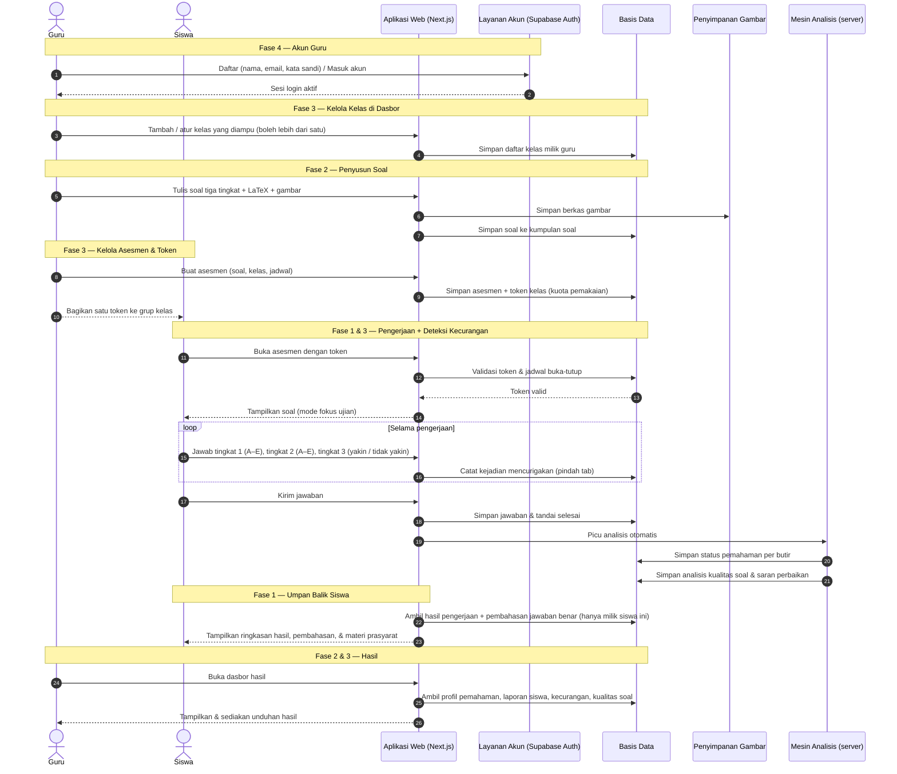
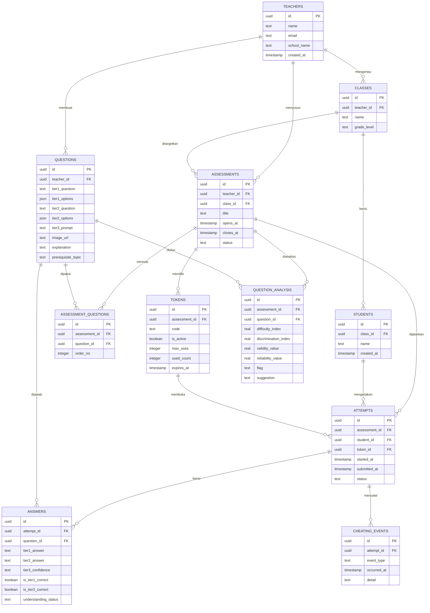

# PRD — SITINDAK (Sistem Tindak Lanjut Diagnostik Asesmen Konsepsi)

## 1. Overview

**Nama produk**
**SITINDAK** — *Sistem Tindak Lanjut Diagnostik Asesmen Konsepsi*.

Nama ini dipakai konsisten sebagai judul aplikasi, judul halaman peramban, teks pada header/masuk, dan sebutan produk di seluruh dokumen. Bagian nama menegaskan dua hal yang menjadi janji produk:
- **Diagnostik Asesmen Konsepsi** — asesmen *three tier* yang tidak berhenti pada benar/salah, tetapi membedakan *sudah paham*, *miskonsepsi*, dan *belum paham*.
- **Tindak Lanjut** — hasil asesmen langsung diterjemahkan menjadi peta materi prasyarat dan laporan per siswa, sehingga guru tahu apa yang harus dilakukan berikutnya, dan siswa tahu apa yang perlu dipelajari ulang.

**Masalah yang diselesaikan**
Guru matematika sering langsung masuk ke materi transformasi geometri tanpa mengetahui bekal awal siswanya. Akibatnya, guru sulit membedakan mana siswa yang benar-benar sudah paham materi prasyarat, mana yang belum paham, dan mana yang mengalami miskonsepsi (memahami sesuatu dengan cara yang salah). Selama ini pengecekan dilakukan manual, memakan waktu, dan hasilnya tidak terdokumentasi rapi.

**Tujuan utama aplikasi**
Menyediakan **SITINDAK**, website asesmen diagnostik *three tier* (tiga tingkat) yang:

1. Dapat dikerjakan siswa secara online dari HP maupun laptop dengan token dari guru.
2. Menganalisis jawaban secara otomatis dan langsung menampilkan profil pemahaman siswa per butir soal (paham / miskonsepsi / belum paham).
3. Memberi guru laporan per siswa dan peta materi prasyarat sebagai dasar menyusun pembelajaran yang sesuai kebutuhan.
4. Membantu guru memantau kualitas soal (validitas, reliabilitas, tingkat kesukaran, daya pembeda) sekaligus menjaga kejujuran pelaksanaan asesmen.
5. Memberi siswa umpan balik tepat setelah asesmen dikirim: hasil pengerjaannya per butir beserta pembahasan jawaban yang benar, sebagai bahan refleksi terhadap materi prasyarat yang diuji.

**Nilai utama:** guru langsung tahu hasilnya — tanpa hitung manual, tanpa menunggu; siswa langsung tahu apa yang perlu diperbaiki.

---

## 2. Requirements

**Kebutuhan fungsional**

- Guru dapat membuat akun dengan data minimal (nama, email, kata sandi), lalu masuk, keluar, mengatur profil & sekolah, dan memulihkan kata sandi.
- Guru dapat menambah dan mengelola beberapa kelas yang diampu, lalu mengelola asesmen tiap kelas dari dasbor.
- Guru dapat menyusun soal tiga tingkat dengan rumus/simbol matematika (LaTeX) dan gambar, lalu menyimpannya dalam kumpulan soal untuk dipakai ulang.
- Guru dapat membuat asesmen (judul, daftar soal, kelas, jadwal buka–tutup) dan menghasilkan **satu token untuk satu kelas** dengan kuota pemakaian sejumlah siswa kelas tersebut.
- Siswa hanya dapat masuk dan mengerjakan asesmen menggunakan token yang masih berlaku.
- Setiap soal disajikan bertingkat: (1) pilihan jawaban A–E, (2) alasan memilih dengan pilihan A–E, (3) tingkat keyakinan siswa yang hanya berupa dua pilihan: **yakin** atau **tidak yakin** (tanpa pilihan A–E).
- Sistem menganalisis jawaban otomatis dan menetapkan status pemahaman per butir soal per siswa.
- Sistem menghitung analisis kualitas soal: tingkat kesukaran, daya pembeda, validitas, dan reliabilitas, serta menandai soal yang perlu diperbaiki.
- Sistem mencatat kejadian mencurigakan (mis. berpindah tab/meninggalkan halaman) dan menyajikannya sebagai laporan kecurangan.
- Setelah mengirim asesmen, siswa menerima umpan balik: hasil pengerjaannya dan pembahasan jawaban yang benar per butir, dikaitkan dengan materi prasyarat yang diuji, sebagai bahan refleksi.

**Kebutuhan non-fungsional**

- **Identitas produk:** aplikasi tampil dengan nama **SITINDAK — Sistem Tindak Lanjut Diagnostik Asesmen Konsepsi**; judul tab peramban, header, halaman masuk guru, dan halaman masuk siswa memakai nama tersebut (bukan nama sementara seperti "Asesmen Diagnostik Geometri").
- **Ramah perangkat:** tampilan menyesuaikan layar HP (layar kecil) sampai laptop.
- **Cepat & andal:** analisis otomatis selesai dalam hitungan detik setelah jawaban dikirim; aman saat puluhan siswa mengerjakan bersamaan.
- **Aman:** token bersifat rahasia dan dibagikan hanya ke kelas terkait; satu token dipakai bersama oleh siswa satu kelas, sehingga **batasnya adalah kuota pemakaian (`max_uses` sejumlah siswa) plus masa berlaku**, bukan sekali pakai per token. Data siswa hanya dapat diakses guru pemilik kelas, kata sandi tersimpan terenkripsi.
- **Umpan balik privat:** halaman hasil siswa hanya menampilkan pengerjaannya sendiri (tidak menampilkan skor atau jawaban siswa lain di kelas yang sama).
- **Mudah dipakai:** guru non-teknis dapat membuat asesmen pertamanya tanpa pelatihan khusus.
- **Skala awal:** 1 sekolah / puluhan guru, ratusan siswa per semester.

---

## 3. Core Features

### Fase 1 — Kerjakan Asesmen
- **Kerjakan Asesmen** — Siswa mengerjakan soal tiga tingkat langsung dari HP atau laptop setelah memasukkan token dari guru.
  - **Masuk dengan Token:** Siswa membuka asesmen hanya dengan token dari guru yang masih berlaku; server memeriksa token, jadwal buka–tutup, dan sisa pemakaian, lalu siswa mengisi nama sebelum mulai mengerjakan.
  - **Soal Tiga Tingkat:** setiap soal disajikan bertingkat — tingkat 1 dan tingkat 2 masing-masing berisi lima pilihan jawaban **A–E** (satu di antaranya benar), sedangkan tingkat 3 hanya berisi dua tombol keyakinan: **yakin** / **tidak yakin**, tanpa pilihan A–E.
  - **Nyaman di HP & Laptop:** tata letak soal menyesuaikan ukuran layar.
  - **Kirim Jawaban:** Siswa mengirim jawaban sekali di akhir pengerjaan; sistem menilai, mengunci jawaban, dan langsung mengarahkan siswa ke halaman hasil & pembahasan.

### Fase 1 — Hasil & Pembahasan untuk Siswa
- **Hasil & Pembahasan untuk Siswa** — Setelah mengirim asesmen, siswa langsung mendapat umpan balik sebagai bahan refleksi belajar.
  - **Ringkasan Hasil Pengerjaan:** siswa melihat hasil pengerjaannya sendiri (jumlah benar, status pemahaman per butir: *sudah paham* / *miskonsepsi* / *belum paham*) tanpa melihat data siswa lain.
  - **Pembahasan Jawaban Benar:** tiap butir menampilkan jawaban yang benar beserta alasannya, ditulis guru saat menyusun soal, agar siswa tahu letak kesalahannya.
  - **Kaitan ke Materi Prasyarat:** pembahasan menandai materi prasyarat apa yang diuji butir tersebut, sehingga siswa tahu bagian mana yang perlu dipelajari ulang.
  - **Bahan Refleksi:** siswa dapat membaca ulang halaman hasil ini selama tautan/sesi pengerjaannya masih berlaku.

### Fase 2 — Profil Pemahaman Siswa
- **Profil Pemahaman Siswa** — Guru langsung melihat hasil asesmen tanpa menghitung manual, lengkap dengan status pemahaman tiap siswa.
  - **Status Pemahaman per Butir:** tiap butir soal ditandai *sudah paham*, *miskonsepsi*, atau *belum paham*.
  - **Peta Materi Prasyarat:** guru mengetahui materi prasyarat mana yang perlu diulang sebelum masuk transformasi geometri.
  - **Laporan Tiap Siswa:** satu ringkasan rapi per siswa yang bisa dibaca ulang kapan saja.
  - **Unduh Hasil:** hasil asesmen dapat diunduh untuk dibagikan atau diarsipkan.

### Fase 2 — Penyusun Soal Tiga Tingkat
- **Penyusun Soal Tiga Tingkat** — Guru menyusun sendiri soal tiga tingkat beserta rumus dan gambar, tanpa aplikasi lain.
  - **Tulis Soal Bertingkat:** Guru membuat soal tiga tingkat dalam satu tampilan: lima opsi A–E + kunci untuk tingkat 1 dan 2, sedangkan tingkat 3 hanya ajakan keyakinan tanpa opsi.
  - **Rumus & Simbol Matematika:** penulisan rumus/simbol matematika (LaTeX) agar tampil rapi di layar siswa.
  - **Tambah Gambar pada Soal:** menyisipkan gambar bangun atau grafik ke dalam butir soal.
  - **Kelola Kumpulan Soal:** menyimpan, mencari, dan memakai ulang soal yang pernah dibuat.

### Fase 3 — Analisis Kualitas Soal
- **Analisis Kualitas Soal** — Guru tahu soal mana yang layak pakai dan mana yang perlu diperbaiki.
  - **Tingkat Kesukaran:** melihat soal yang terlalu mudah atau terlalu sulit.
  - **Daya Pembeda:** melihat soal yang mampu membedakan siswa paham dan belum paham.
  - **Validitas & Reliabilitas:** mengetahui sejauh mana soal dan hasil asesmen dapat dipercaya.
  - **Saran Perbaikan Soal:** soal bermasalah ditandai agar mudah diperbaiki.

### Fase 3 — Kelola Kelas di Dasbor
- **Kelola Kelas di Dasbor** — Satu guru sering mengampu lebih dari satu kelas, jadi setiap kelas punya ruang kelola asesmennya sendiri di dasbor.
  - **Tambah & Atur Kelas:** guru menambah, mengganti nama, dan menghapus kelas yang diampu (mis. IX-A, IX-B) langsung dari dasbor — tanpa perlu mengulang pendaftaran akun.
  - **Dasbor per Kelas:** tiap kelas menampilkan asesmen, token, jadwal, dan status pengerjaan siswanya sendiri.
  - **Pilih Kelas Saat Membuat Asesmen:** asesmen dan token dibuat untuk satu kelas yang dipilih dari daftar kelas guru.

### Fase 3 — Kelola Asesmen & Token
- **Kelola Asesmen & Token** — Guru menyiapkan asesmen, membagikan satu token kelas dengan kuota pemakaian, dan memantau siapa yang sudah mengerjakan.
  - **Buat Asesmen:** menentukan judul, daftar soal, dan kelas yang mengerjakan.
  - **Token untuk Siswa:** Guru membuat satu token per kelas untuk satu pelaksanaan asesmen; masa berlaku dan kuota pemakaian sejumlah siswa ditetapkan saat pembuatan.
  - **Jadwal Buka-Tutup:** mengatur kapan asesmen dibuka dan ditutup.
  - **Status Pengerjaan:** melihat daftar siswa yang sudah/belum menyelesaikan.

### Fase 3 — Deteksi Kecurangan
- **Deteksi Kecurangan** — Guru mendapat tanda saat siswa mengerjakan dengan cara tidak wajar.
  - **Pantau Aktivitas Mencurigakan:** mencatat saat siswa berpindah tab atau meninggalkan halaman asesmen.
  - **Mode Fokus Ujian:** layar asesmen dibuat fokus sehingga sulit membuka bantuan dari luar.
  - **Laporan Kecurangan:** daftar kejadian mencurigakan per siswa setelah asesmen selesai.

### Fase 4 — Akun Guru
- **Akun Guru** — Guru mendaftar sekali lalu bisa masuk kembali untuk mengelola asesmennya.
  - **Daftar Akun Guru:** cukup nama, email, dan kata sandi — tanpa memilih sekolah atau kelas di awal.
  - **Masuk & Keluar:** akses akun yang aman.
  - **Atur Profil & Sekolah:** melengkapi nama, sekolah, dan profil setelah akun aktif; daftar kelas yang diampu dikelola di dasbor, bukan saat mendaftar.
  - **Lupa Kata Sandi:** memulihkan akses saat kata sandi terlupa.

> Catatan urutan: pendaftaran akun (Fase 4) tetap menjadi **langkah pertama** yang dijalani guru di aplikasi, sementara fitur siswa (Fase 1) menjadi pengalaman yang dinilai lebih dulu sebagai "kemenangan pertama" produk.

## 4. User Flow

**A. Alur Guru**

1. **Daftar akun guru** (Fase 4) → isi nama, email, kata sandi → masuk ke dasbor → **tambah kelas yang diampu** (mis. IX-A, IX-B) dari dasbor.
2. **Menyusun soal** (Fase 2) → tulis soal tiga tingkat (jawaban, alasan, keyakinan), sisipkan rumus LaTeX dan gambar → simpan ke kumpulan soal.
3. **Membuat asesmen** (Fase 3) → pilih judul, daftar soal, kelas, jadwal buka–tutup → sistem membuat token.
4. **Membagikan token** ke siswa (lewat grup kelas/papan tulis).
5. **Memantau status pengerjaan** (Fase 3) → lihat siapa sudah/belum mengerjakan, serta laporan kecurangan bila ada.
6. **Melihat hasil otomatis** (Fase 2) → buka profil pemahaman per butir soal, peta materi prasyarat, dan laporan tiap siswa → unduh bila perlu.
7. **Memeriksa kualitas soal** (Fase 3) → tinjau tingkat kesukaran, daya pembeda, validitas & reliabilitas, ikuti saran perbaikan.
8. **Menyusun pembelajaran** berdasarkan hasil tersebut, lalu ulangi siklus dari langkah 2/3 untuk asesmen berikutnya.

**B. Alur Siswa**

1. Menerima **token** dari guru.
2. Buka website asesmen di HP/laptop → masukkan token dan nama.
3. Sistem memeriksa token + jadwal → jika valid, soal tampil.
4. Mengerjakan **soal tiga tingkat** satu per satu: tingkat 1 memilih satu jawaban dari **A–E**, tingkat 2 memilih satu alasan dari **A–E**, lalu tingkat 3 memilih **yakin** atau **tidak yakin**. Layar dalam **mode fokus ujian**; perpindahan tab dicatat.
5. **Kirim jawaban** sekali → sistem menilai jawaban → siswa langsung dibawa ke **halaman hasil & pembahasan**.
6. **Membaca umpan balik** → siswa melihat ringkasan hasil pengerjaannya, pembahasan jawaban benar tiap butir, dan materi prasyarat yang perlu dipelajari ulang sebagai bahan refleksi. Hasil siswa lain tetap tidak terlihat.

---

## 5. Architecture

**Gambaran sistem**
Aplikasi berbentuk web (satu basis kode untuk guru dan siswa) dengan tiga lapis: halaman web (Next.js), logika & API di server, dan basis data relasional. Gambar soal disimpan di penyimpanan berkas, sedangkan rumus LaTeX disimpan sebagai teks dan dirender di sisi siswa (KaTeX). Analisis pemahaman dan kualitas soal dijalankan di server tepat setelah jawaban dikirim, sehingga guru dapat langsung melihat hasil.

**Komponen utama**

| Komponen | Peran |
|---|---|
| Web App (Next.js) | Halaman guru & siswa, halaman hasil & pembahasan siswa, render rumus LaTeX, tampilan responsif |
| Layanan Akun | Pendaftaran, login/logout, lupa kata sandi, sesi guru — disediakan **Supabase Auth** |
| API Server | Validasi token, penyimpanan jawaban, pemicu analisis |
| Mesin Analisis | Penentuan status pemahaman per butir; hitung kesukaran, daya pembeda, validitas, reliabilitas |
| Basis Data | PostgreSQL terkelola **Supabase**: akun, kelas, siswa, soal, asesmen, token, jawaban, kejadian kecurangan, hasil analisis |
| Penyimpanan Gambar | **Supabase Storage** (bucket gambar soal) |
| Pencatat Aktivitas | Mencatat pindah tab / keluar halaman selama ujian |
| Penjaga Akses Data | **Supabase Row Level Security (RLS)** — membatasi baris mana yang boleh dibaca/ditulis per peran |

**Keamanan akses data (Supabase RLS)**

- RLS **diaktifkan di semua tabel aplikasi** (`teachers`, `classes`, `students`, `questions`, `assessments`, `assessment_questions`, `tokens`, `attempts`, `answers`, `cheating_events`, `question_analysis`) — tidak ada tabel yang dibiarkan terbuka.
- Akses data aplikasi **hanya lewat Server Action / API Route di server** memakai koneksi server (`SUPABASE_SERVICE_ROLE_KEY` / `DATABASE_URL`). **Anon key tidak dipakai untuk query langsung ke tabel** dari browser, sehingga siswa tidak bisa membaca tabel dengan membuka DevTools.
- Halaman siswa **tidak memerlukan login akun**: siswa masuk dengan token + nama. Server yang memvalidasi token, membuat `attempts`, dan menyimpan `answers`; identitas siswa ditentukan server dari token, bukan dari input bebas di klien.
- Isolasi data guru: guru hanya dapat membaca/menulis baris miliknya (`teachers.id = auth.uid()`), dan baris turunannya (`classes`, `questions`, `assessments`) dibatasi lewat `teacher_id`/`class_id` yang berantai ke guru tersebut — guru lain tidak bisa membuka kelas atau hasil siswanya meski tahu ID-nya.
- Isolasi data siswa: `answers`, `attempts`, dan `cheating_events` hanya dapat dibaca untuk `attempt` milik siswa yang bersangkutan (halaman hasil & pembahasan bersifat privat) atau oleh guru pemilik asesmen.
- `students` dan `tokens` tidak dapat diakses langsung dari klien; pembacaan hanya lewat server setelah token divalidasi dan jadwal buka–tutup diperiksa.
- Service role key bersifat rahasia: disimpan sebagai environment variable server saja, **tidak pernah** diekspos ke bundle klien (`NEXT_PUBLIC_*`), dan tidak dipakai di komponen React.

---

## 6. Database Schema

**Konvensi ID (uuid)**
- Semua primary key `id` bertipe `uuid` dengan default `gen_random_uuid()` — tidak ada lagi PK bertipe `text`.
- Pengecualian: `teachers.id` **tidak** memakai default; nilainya diambil dari `auth.users.id` Supabase Auth, dengan constraint `references auth.users(id) on delete cascade` (akun auth dihapus → baris `teachers` ikut terhapus).
- Semua kolom relasi (`teacher_id`, `class_id`, `question_id`, `assessment_id`, `student_id`, `token_id`, `attempt_id`) bertipe `uuid` (FK) yang menunjuk ke PK uuid di atas — tipe PK dan FK dijamin setipe.
- Kolom waktu (`created_at`, `started_at`, `occurred_at`) memakai default `now()`; kolom yang boleh kosong (`submitted_at`, `expires_at`) dibiarkan nullable.

**1. `teachers` — akun guru**
- `id` (uuid, primary key, FK → `auth.users.id` on delete cascade) — nilainya sama dengan `auth.users.id` milik Supabase Auth, bukan `gen_random_uuid()`
- `name` (text) — nama guru (wajib saat daftar)
- `email` (text, unique) — email untuk masuk (wajib saat daftar, tersinkron dari Supabase Auth)
- `password_hash` (text, nullable) — **tidak dipakai**: kata sandi disimpan & dikelola Supabase Auth di skema `auth`, bukan di tabel aplikasi
- `school_name` (text, nullable) — nama sekolah, dilengkapi saat atur profil setelah daftar
- `created_at` (timestamp) — waktu pendaftaran

**2. `classes` — kelas yang diampu (dikelola dari dasbor)**
- `id` (uuid, PK)
- `teacher_id` (uuid, FK → teachers) — satu guru boleh punya banyak kelas
- `name` (text) — mis. "IX-B"
- `grade_level` (text) — tingkat kelas
- `created_at` (timestamp) — waktu kelas ditambahkan

**3. `students` — daftar siswa**
- `id` (uuid, PK)
- `class_id` (uuid, FK → classes)
- `name` (text) — nama siswa (dipakai saat masuk dengan token)
- `created_at` (timestamp)

**4. `questions` — kumpulan soal tiga tingkat**
- `id` (uuid, PK)
- `teacher_id` (uuid, FK → teachers)
- `title` (text) — judul singkat soal
- `tier1_question` (text) — pertanyaan tingkat 1 (berisi LaTeX)
- `tier1_options` (json) — lima pilihan jawaban berlabel **A–E** (mis. `{"A": "...", "B": "...", "C": "...", "D": "...", "E": "..."}`) + `correct_option` (salah satu dari A–E)
- `tier2_question` (text) — pertanyaan tingkat 2 (alasan)
- `tier2_options` (json) — lima pilihan alasan berlabel **A–E** + `correct_option` (salah satu dari A–E)
- `tier3_prompt` (text) — pertanyaan tingkat 3 (ajakan keyakinan); **tidak punya pilihan A–E**, jawaban hanya `yakin` atau `tidak yakin`
- `image_url` (text, nullable) — gambar soal
- `explanation` (text, nullable) — pembahasan jawaban benar + alasan tingkat 2, ditampilkan ke siswa di halaman hasil sebagai bahan refleksi
- `prerequisite_topic` (text) — materi prasyarat yang diukur (ikut ditampilkan di pembahasan siswa)
- `created_at` (timestamp)

**5. `assessments` — asesmen yang dilaksanakan**
- `id` (uuid, PK)
- `teacher_id` (uuid, FK → teachers)
- `class_id` (uuid, FK → classes)
- `title` (text)
- `opens_at` (timestamp) — jadwal buka
- `closes_at` (timestamp) — jadwal tutup
- `status` (text) — draf / berjalan / selesai

**6. `assessment_questions` — soal dalam sebuah asesmen**
- `id` (uuid, PK)
- `assessment_id` (uuid, FK → assessments)
- `question_id` (uuid, FK → questions)
- `order_no` (integer) — urutan tampil

**7. `tokens` — token akses siswa**
- `id` (uuid, PK)
- `assessment_id` (uuid, FK → assessments)
- `code` (text, unique) — kode token
- `is_active` (boolean) — status berlaku
- `max_uses` (integer) — kuota pemakaian; diisi otomatis sejumlah siswa di kelas saat token dibuat
- `used_count` (integer) — jumlah pemakaian; naik satu setiap ada siswa baru yang berhasil masuk
- `expires_at` (timestamp) — batas waktu token masih bisa dipakai

> Satu token mewakili **satu kelas pada satu pelaksanaan asesmen**, bukan satu token per siswa. Token berhenti berlaku bila `is_active = false`, `expires_at` lewat, atau `used_count >= max_uses`. Siswa yang sudah pernah masuk dengan token tersebut melanjutkan `attempts`-nya tanpa menambah `used_count`.

**8. `attempts` — sesi pengerjaan siswa**
- `id` (uuid, PK)
- `assessment_id` (uuid, FK → assessments)
- `student_id` (uuid, FK → students)
- `token_id` (uuid, FK → tokens)
- `started_at` (timestamp)
- `submitted_at` (timestamp, nullable)
- `status` (text) — berlangsung / terkirim

**9. `answers` — jawaban tiga tingkat per butir**
- `id` (uuid, PK)
- `attempt_id` (uuid, FK → attempts)
- `question_id` (uuid, FK → questions)
- `tier1_answer` (text) — jawaban tingkat 1: salah satu opsi **A–E**
- `tier2_answer` (text) — alasan tingkat 2: salah satu opsi **A–E**
- `tier3_confidence` (text) — hanya `yakin` atau `tidak yakin` (tidak memakai opsi A–E)
- `is_tier1_correct` (boolean)
- `is_tier2_correct` (boolean)
- `understanding_status` (text) — paham / miskonsepsi / belum paham

**10. `cheating_events` — catatan aktivitas mencurigakan**
- `id` (uuid, PK)
- `attempt_id` (uuid, FK → attempts)
- `event_type` (text) — pindah tab / keluar halaman / keluar mode fokus
- `occurred_at` (timestamp)
- `detail` (text, nullable)

**11. `question_analysis` — hasil analisis kualitas soal**
- `id` (uuid, PK)
- `assessment_id` (uuid, FK → assessments)
- `question_id` (uuid, FK → questions)
- `difficulty_index` (real) — tingkat kesukaran
- `discrimination_index` (real) — daya pembeda
- `validity_value` (real) — nilai validitas
- `reliability_value` (real) — reliabilitas asesmen
- `flag` (text) — layak / perlu diperbaiki
- `suggestion` (text) — saran perbaikan

---

## 7. Tech Stack

| Lapisan | Rekomendasi | Alasan singkat |
|---|---|---|
| Frontend | **Next.js (App Router) + React + TypeScript** | Satu basis kode untuk halaman guru & siswa, cepat, ramah SEO, mudah di-deploy |
| Styling & UI | **Tailwind CSS + shadcn/ui** | Tampilan responsif (HP & laptop) cepat dibuat, komponen siap pakai |
| Rumus Matematika | **KaTeX** (+ editor LaTeX sederhana) | Render rumus/simbol matematika rapi dan ringan di layar siswa |
| Form & Validasi | **React Hook Form + Zod** | Validasi input soal, token, dan jadwal secara konsisten |
| Backend | **Next.js API Routes / Server Actions** | Cukup untuk skala sekolah, mengurangi jumlah layanan yang harus dikelola |
| Analisis Otomatis | **Modul analisis di server (TypeScript)** | Hitung status pemahaman per butir, kesukaran, daya pembeda, validitas, reliabilitas |
| Database | **Supabase PostgreSQL** (managed) | Satu penyedia untuk data, auth, dan storage; naik skala tanpa mengubah struktur tabel relasional |
| ORM | **Drizzle ORM** (driver `postgres`) | Skema jelas, migrasi mudah, tipe aman di atas PostgreSQL |
| Autentikasi | **Supabase Auth** | Daftar, masuk/keluar, lupa kata sandi, dan sesi guru siap pakai; terhubung langsung ke PostgreSQL |
| Penyimpanan Gambar | **Supabase Storage** | Menyimpan gambar soal di bucket khusus tanpa membebani basis data, URL publik/CDN |
| Keamanan Data | **Supabase Row Level Security (RLS)** | RLS aktif di semua tabel; akses hanya lewat Server Action memakai service role, anon key tidak dipakai untuk query tabel langsung |
| Deployment | **Vercel** | Deploy otomatis dari repositori, HTTPS, cocok dengan Next.js; koneksi ke Supabase lewat environment variable |
| Tambahan | **Recharts** (grafik hasil), **ExcelJS / jsPDF** (unduh hasil), **Zustand** (state pengerjaan soal) | Menunjang laporan, unduhan, dan pengalaman ujian yang mulus |

**Catatan pemilihan:** seluruh backend disatukan di **Supabase** — PostgreSQL (basis data), Supabase Auth (akun guru: daftar, masuk, lupa kata sandi), dan Supabase Storage (gambar soal) — sehingga tidak perlu layanan auth/storage terpisah. Frontend Next.js di-deploy ke **Vercel**. Untuk pengembangan lokal, pakai **Supabase CLI** (Postgres + Auth + Storage berjalan lokal) atau satu project Supabase gratis, lalu set kredensial (`DATABASE_URL`, `NEXT_PUBLIC_SUPABASE_URL`, `SUPABASE_ANON_KEY`, `SUPABASE_SERVICE_ROLE_KEY`) sebagai environment variable di Vercel. Struktur tabel tetap ditulis sebagai SQL biasa lewat Drizzle, jadi tidak terikat fitur khusus penyedia. **RLS Supabase wajib diaktifkan** di setiap tabel aplikasi dan dijalankan sebagai bagian dari migrasi Drizzle, sehingga tabel baru tidak pernah lahir dalam keadaan terbuka. Karena basis data sudah PostgreSQL sejak awal, tidak ada migrasi penyedia saat jumlah guru/siswa bertambah atau asesmen dikerjakan serentak.